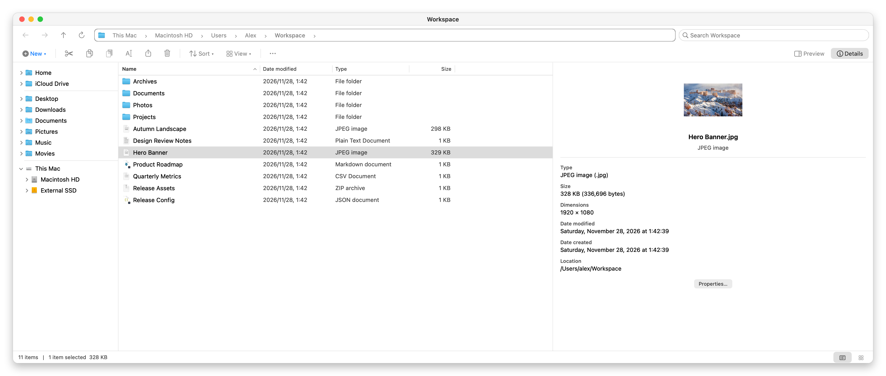
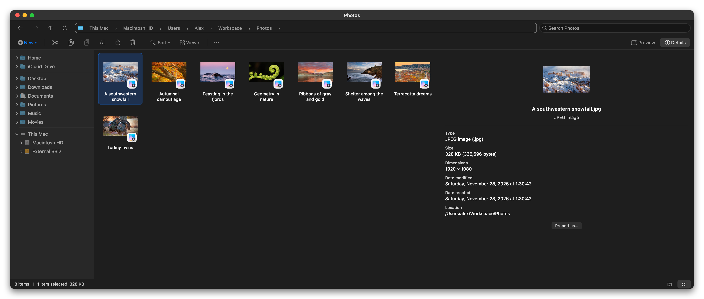
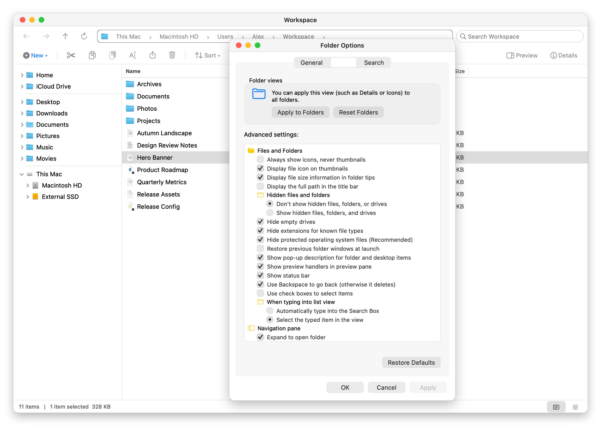
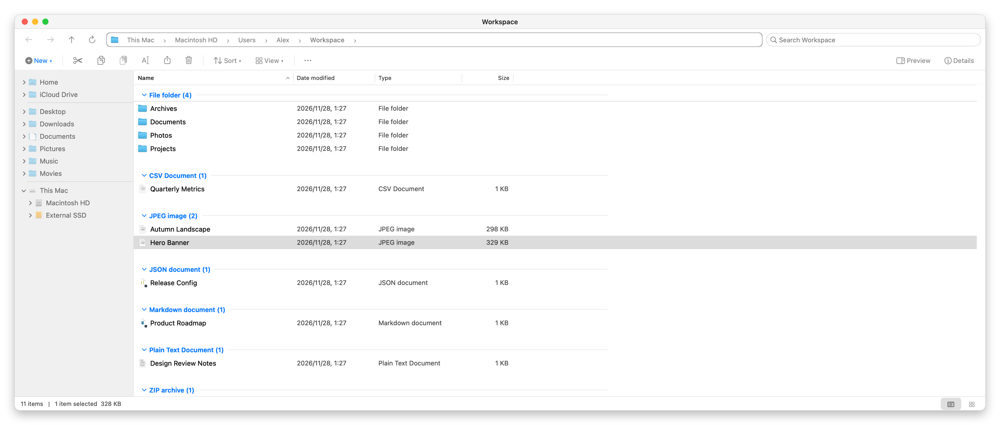
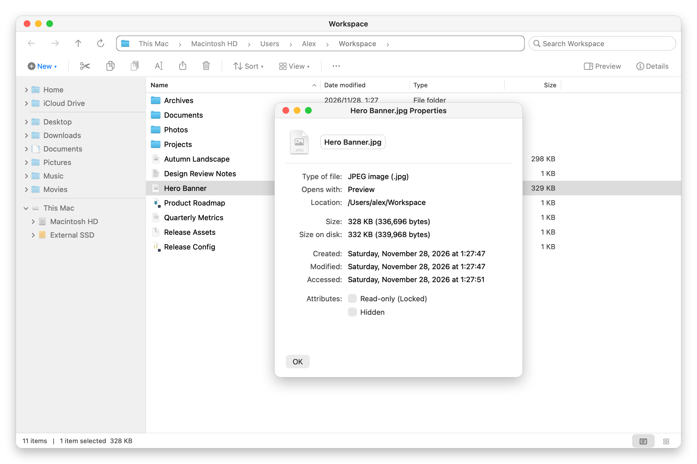
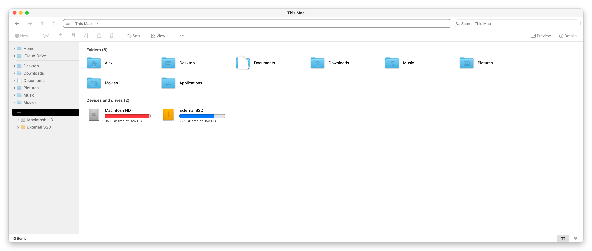
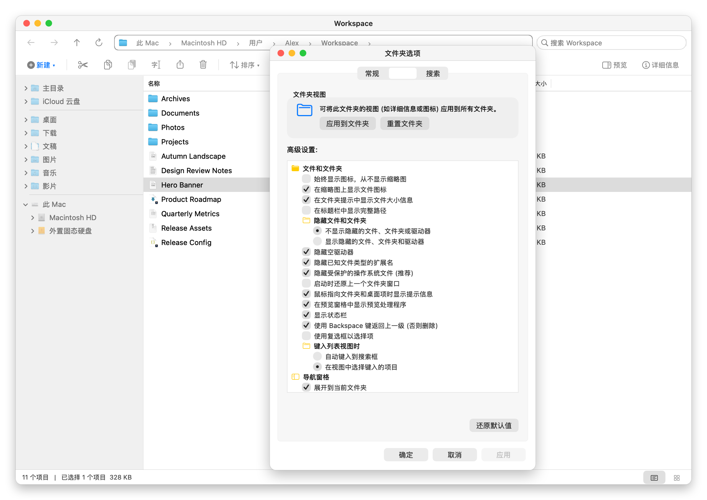
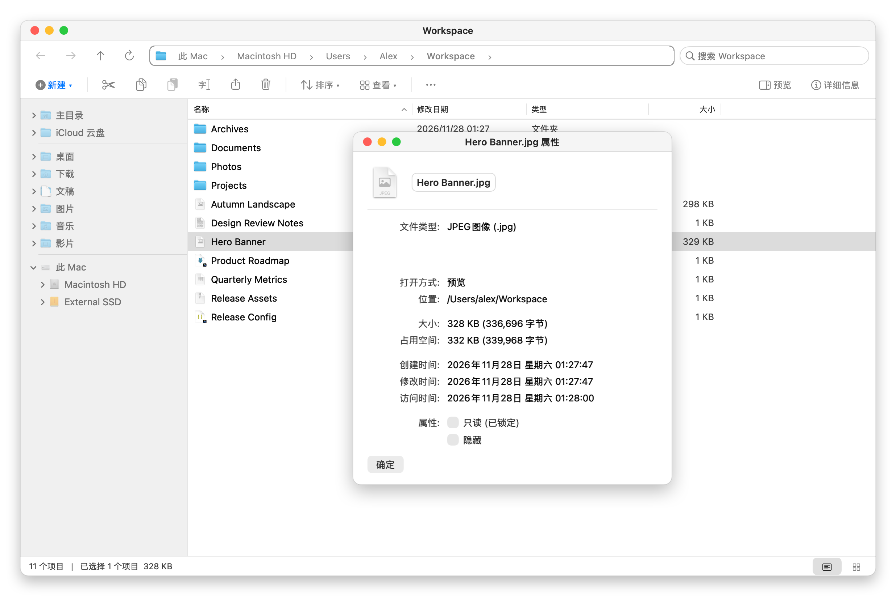

<div align="center">

# Arbor

**The Windows File Explorer experience, built natively for macOS.**

[](https://github.com/iebb/arbor/actions/workflows/ci.yml)


Real Cut & Paste (`⌘X` / `⌘V`) · `Enter` to open · `F2` to rename · `Backspace` to go back · Breadcrumbs · Folder tree · Details & Preview panes · Native AppKit speed

<br/>



</div>

---

## Why Arbor?

Switching from Windows to macOS often means relearning decades of file-management muscle memory. **Arbor** brings the full Windows 11 File Explorer workflow to Mac — written from scratch in **Swift and AppKit** (no Electron, no web views) so it stays fast, lightweight, and native with macOS tabs, Quick Look, Finder drag-and-drop, and Dark Mode.

- **Familiar muscle memory:** `⌘X` / `⌘V` really cuts and moves files (with dimmed cut items and `Esc` to cancel), `Enter` opens, `F2` renames (selecting only the base name), and `Backspace` goes back.
- **Full Explorer layout:** Folder tree on the left, clickable breadcrumb bar you can type paths into, command bar, 8 icon/list/details/content layouts, collapsible groups, Preview & Details panes, and status bar.
- **Native macOS performance:** Spotlight-accelerated search, asynchronous icon & Quick Look thumbnail loading, native macOS window tabs, Trash support, and full Dark Mode.
- **11 languages:** English, 简体中文, 繁體中文, 日本語, 한국어, Español, Français, Deutsch, Português (Brasil), Italiano, and Русский — using Windows 11 Explorer's native terminology.

---

## Screenshots

| Large Icons & Details Pane (Dark Mode) | Folder Options (Settings) |
| :---: | :---: |
|  |  |

| Collapsible Groups | Properties Dialog |
| :---: | :---: |
|  |  |

<div align="center">



</div>

<details>
<summary><strong>简体中文界面截图 / Simplified Chinese Screenshots</strong></summary>

<br/>

| 详细信息与详细信息窗格 | 深色模式大图标 |
| :---: | :---: |
|  |  |

| 文件夹选项 | 文件属性 |
| :---: | :---: |
|  |  |

</details>

---

## Features

### Window & Navigation
- **Native macOS tabs** — `⌘T`, tab bar `+`, *Open in new tab*, or **middle-click** any folder in the file view or navigation pane.
- **Breadcrumb address bar** — Back, Forward, Up, and Refresh buttons; clickable path segments with subfolder dropdowns; automatic `«` overflow menu; right-click Back/Forward for history. Click empty space (or press `⌘L` / `⌥D` / `F4`) to type paths with inline folder autocomplete (`~`, relative paths, quoted paths, `This Mac`, `\\server\share`, `smb://…`).
- **Spotlight-backed search** — Searches the current folder and subfolders as you type using Spotlight (`MDQuery`) for instant results, with automatic filesystem fallback for unindexed volumes, hidden items, and ZIP archives. Supports wildcards (`*.pdf`, `IMG_????.jpg`) and optional content search.
- **Navigation pane** — Home, iCloud Drive, pinned Quick access folders, frequent folders, and This Mac › drives › folders. Auto-expands to the open folder and accepts drag-and-drop onto any folder.
- **Command bar & status bar** — `New ▾` · Cut · Copy · Paste · Rename · Share · Delete · `Sort ▾` · `View ▾` · `⋯` · Preview · Details, plus live item count, selection count/size, and quick Details / Large Icons toggles.

### Views & Panes
- **All 8 Explorer layouts** (`⌃⇧1`…`8`) — Extra large, Large, Medium, and Small icons, List, **Details**, Tiles, and **Content**. Every folder remembers its own layout, sort order, and grouping.
- **Details view** — Name, Date modified, Type, Size (in KB, like Explorer), Date created, and Folder (in search results). Natural sorting (`file2` before `file10`), folders grouped first, column show/hide, drag-to-reorder, and *Size All Columns to Fit*.
- **Collapsible groups** — Group by Name, Date modified (*Today*, *Yesterday*, *Last week*…), Type, or Size (*Tiny*, *Small*, *Medium*…). Click any group header to collapse/expand, or right-click to collapse/expand all.
- **Preview pane (`⌥P`) & Details pane (`⌥⇧P`)** — Quick Look preview pane, or Windows 11–style Details pane showing large thumbnails, file type, exact byte size, live folder size & item count, image/video dimensions, audio/video duration, PDF page count, dates, and location.
- **This Mac** — Quick overview of user folders, mounted drives with rounded capacity bars, and mapped network locations.

### File Operations
- **True Cut, Copy & Paste** — Works with Finder through the system clipboard; cut items are dimmed until pasted (press `Esc` to cancel). Pasting into the same folder creates `name - Copy.ext`, `name - Copy (2).ext`.
- **Smart conflict handling & folder merge** — Replace, Skip, or Keep Both with *Do this for all*. Existing folders can be merged (asks once at the top level; nested folders merge silently and only prompt on clashing files).
- **Drag and drop** — Same volume moves, different volume copies; hold `⌥` to copy or `⌘` to move. Works within Arbor, across tabs, and with Finder.
- **Inline & batch rename** — `F2` or slow second click selects only the base name. Select multiple items and rename one to generate `Holiday (1).jpg`, `Holiday (2).jpg`… Warns before changing a visible extension.
- **Safe delete & full Undo/Redo** — `Delete` / `⌘⌫` moves to Trash; `⇧Delete` / `⌥⌘⌫` deletes permanently after confirmation. App-wide `⌘Z` / `⇧⌘Z` undoes and redoes copy, move, rename, delete, new folder/file, and compress operations.
- **Built-in utilities** — Compress to ZIP, Extract All, Copy as path (`⌥⌘C`), Open with ▸, Share ▸, Open in Terminal, Show in Finder, Pin to Quick access, Eject, and **Properties** (`⌥Return` / `⌘I`) with live size on disk, contents count, dates, Read-only, and Hidden attributes.

### Network, Hotkey & Folder Options
- **Network shares** — Connect to Server (`⌘K`) and Map network drive for SMB, AFP, NFS, WebDAV, and FTP (`\\server\share` or `smb://server/share`), with optional reconnect at launch.
- **Open from anywhere** — Optional global hotkey (e.g. `⌥⌘E`, like `Win+E`) and *Open at login*.
- **Folder Options (`⌘,`)** — Explorer's 3-tab dialog (*General*, *View*, *Search*) with OK / Cancel / Apply and Restore Defaults: start location, single-click to open (with hover underline), item check boxes, compact view, hide extensions for known file types, hidden & protected OS files, restore previous windows at launch, Backspace behavior, type-into-search, and more.

---

## Keyboard Shortcuts

Explorer shortcuts work alongside standard Mac shortcuts (on a Mac keyboard, Alt is `⌥`):

| Action | Explorer | Mac |
| --- | --- | --- |
| Open selected item | `Enter` | `⌘↓` |
| Open folder in new tab | Middle-click | |
| Back / Forward | `⌥←` / `⌥→`, `Backspace` | `⌘[` / `⌘]` |
| Up one level | `⌥↑` | `⌘↑` |
| Rename | `F2` | |
| Cut / Copy / Paste | | `⌘X` / `⌘C` / `⌘V` |
| Cancel pending Cut | `Esc` | `Esc` |
| Copy as path | | `⌥⌘C` |
| Undo / Redo | | `⌘Z` / `⇧⌘Z` |
| Delete to Trash | `Delete (⌦)` | `⌘⌫` |
| Delete permanently | `⇧Delete` | `⌥⌘⌫` |
| New folder / New text file | `⌃⇧N` | `⇧⌘N` / `⌥⌘N` |
| Edit address bar | `⌥D`, `F4` | `⌘L`, `⇧⌘G` |
| Search | `F3` | `⌘F` |
| Refresh | `F5` | `⌘R` |
| Properties | `⌥Enter` | `⌘I` |
| Preview pane | `⌥P` | `⌥⌘P` |
| Details pane | `⌥⇧P` | `⇧⌥⌘P` |
| Quick Look | | `Space`, `⌘Y` |
| Switch layout (1…8) | `⌃⇧1`…`8` | `⌃⇧1`…`8` |
| Connect to Server | | `⌘K` |
| First / Last item | `Home` / `End` | |
| New window / tab / close tab | | `⌘N` / `⌘T` / `⌘W` |
| This Mac / Home / Hidden items | | `⇧⌘C` / `⇧⌘H` / `⇧⌘.` |

---

## Editions

Arbor builds two editions from the same codebase:

| | Direct Download (`Arbor`) | Mac App Store (`Arbor Files`) |
| --- | --- | --- |
| **Distribution** | GitHub Releases (notarized) | Mac App Store / TestFlight |
| **Sandbox** | No (uses standard macOS folder permissions / Full Disk Access) | Yes (grants disk access once via security-scoped bookmark) |
| **Updates** | Sparkle automatic updates | App Store |
| **Set as default folder viewer** | Yes | No (sandbox restriction) |

---

## Building from Source

**Requirements:** macOS 14+, Xcode 16+, and [XcodeGen](https://github.com/yonaskolb/XcodeGen) (`brew install xcodegen`).

```bash
make run      # generate Arbor.xcodeproj, build Debug, and launch Arbor
make test     # run all 40 unit tests
make app      # build Release Arbor.app into build/
```

Launch at a specific folder or language:

```bash
build/DerivedData/Build/Products/Debug/Arbor.app/Contents/MacOS/Arbor ~/Downloads
build/DerivedData/Build/Products/Debug/Arbor.app/Contents/MacOS/Arbor -AppleLanguages "(zh-Hans)"
```

### Architecture

```text
Arbor/
  App/            AppDelegate (windows, tabs, key monitor), MainMenu, BrowserWindowController
  Core/           Pure, unit-tested model: FileItem, Location, NavigationHistory, ViewSettings
                  & FileGrouping, NameGenerator, Format, PathResolver, Preferences
  Services/       DirectoryLoader, async DirectoryWatcher, Spotlight SearchService, VolumeService,
                  IconCache, ThumbnailProvider, FileClipboard, FileOperations, TransferPlanner,
                  NetworkLocations, GlobalHotKey, Distribution (Edition, SandboxAccess, Sparkle)
  UI/
    Browser/      BrowserViewController (+Commands, +Menus, +Delegates) — single command path
    AddressBar/   Breadcrumbs, path editing with autocomplete, search box
    CommandBar/   Command bar and status bar
    NavigationPane/ Lazy folder tree with auto-reveal and drag-and-drop
    Content/      ItemPresenter protocol, DetailsViewController, IconGridViewController (7 layouts),
                  ThisMacViewController, PreviewPaneController, DetailsPaneController
    Panels/       Properties, Folder Options, transfer progress
  Resources/      Assets, Info plists, 11 localizations (*.lproj)
ArborTests/       Unit tests for Core, Search, Grouping, Folder Merge, Network, and Clipboard
```

---

## License

Arbor is open-source software released under the [MIT License](LICENSE).
